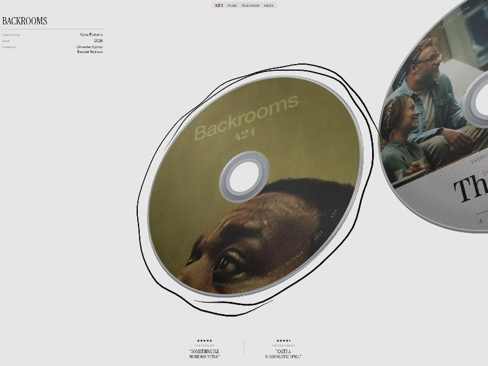

# A24 — Films · 三维光盘轮播

复刻自 [a24.raviklaassens.com](https://a24.raviklaassens.com/)（作者 Ravi Klaassens），
调研与复刻日期 2026-10-17。



12 部电影各对应一张 CD，排成一道弧线。滚轮、拖拽、键盘推动轮播，
当前光盘居中放大，左上信息面板与底部影评随之用行遮罩切换；
hover 当前光盘会出现手绘圈，空格翻到背面的虹彩数据面。

Films / Television 两套目录共用同一套渲染，点光盘进详情页，
三者之间用 Barba 做无刷新切换 —— 整个过程 WebGL canvas 一次都不重建。

## 跑起来

需要 HTTP 服务（importmap 不能走 `file://`）：

```bash
python3 -m http.server 4178
```

打开 <http://localhost:4178/remakes/a24-disc-gallery/>。
加 `?debug` 会把 `shell` / `gallery` / `CONFIG` / `barba` 挂到 `window` 上。

站点本身零构建。只有改页面模板或增删条目时，才需要重新生成那 20 个静态页：

```bash
node tools/build-pages.mjs
```

产物照常提交进仓库，访问者不需要 Node。详见「页面怎么来的」。

## 操作

| 操作 | 效果 |
|---|---|
| 滚轮 / 触控板 | 一次手势走一格 |
| 拖拽空白处 | 拖动轮播，松手带惯性 |
| 拖拽当前光盘 | 转动这张盘，松手弹回 |
| 点击非当前光盘 | snap 过去 |
| 点击当前光盘 / Enter | 打开详情 |
| 空格 | 翻面 |
| ← → / Home / End | 前后一格 / 首尾 |
| 导航 Films / Television | 换目录，当前盘翻面交接 |
| 详情页 Close / Esc 返回 | 回到来的那一页，光盘转正飞回 |

## 技术栈

只有两个依赖，都走 CDN：

- `three@0.178.0` —— 3D 渲染。原站 `THREE.REVISION === "178"`，这里对齐同一版，
  因为背面的 `iridescence`（薄膜干涉）在这个版本是内置特性。
- `gsap@3.15.0` —— tween 与时间轴。

- `@barba/core@2.10.3` —— 多页无刷新切换。三个命名空间 films / television / production，
  和原站一致。

原站还用了 Lenis（平滑滚动）。首屏本身不滚动，详情页内容也不长，
这里没引入 —— 省一个依赖，手感差别不明显。

## 实现要点

### 光盘（`src/disc.js`）

一张光盘是 6 个 Mesh 加一个隐藏的拾取圆：

| Mesh | 几何 | 作用 |
|---|---|---|
| front | `RingGeometry(0.24, 0.974, 220)`，UV 重映射为平面投影 | 封面印刷面 |
| back | 同上，`rotation.y = π` | 数据面（虹彩） |
| edge | `LatheGeometry` 六点轮廓，含倒角 | 外缘白边 |
| hub | `LatheGeometry`，半径 0.214 → 0.24 | 透明塑料环 |
| matrix | `LatheGeometry`，半径 0.174 → 0.214 | 银色镜面环 |
| frost | `LatheGeometry`，半径 0.14 → 0.174 | 磨砂内环 |
| pick | `CircleGeometry(1, 24)`，不可见 | Raycaster 命中用 |

`RingGeometry` 默认是极坐标 UV，封面会被绕圈拉开，所以按顶点位置重映射成平面投影。
中心三个环的轮廓在厚度方向叠了 `cos(t·3π)` 的波浪，做出真实 CD 中心的多道台阶。

**质感 70% 来自光照与环境贴图，不是几何。** 环境贴图是一张 1024×512 的 canvas：
深色竖向渐变 (`#25282f → #0e0f13 → #020203`) 加四道亮条，经 `PMREMGenerator` 生成。
没有 HDR 文件。盘面上那道横贯的长条高光来自一盏 `RectAreaLight(6 × 0.4)`。

### 程序化贴图（`src/textures.js`）

四张贴图全部用像素循环生成，零外部美术资源：

- **frontNormal** —— 同心光学纹 `sin(r*0.6)*0.02` + 印刷颗粒噪声 − 10 条随机划痕 + 180 个灰尘点，经 Sobel 差分转法线
- **backNormal** —— 密集同心环 `sin(r*3.2)*0.5`，虹彩的方向性靠它
- **frontRough** —— 基础 0.42 + 高低频噪声 − 同心光泽带
- **backRough** —— 基础 0.23 + 低频环带 + 轻噪声

封面合成用 `ctx.clip('evenodd')` 一次裁出圆环（挖掉中心孔），底色 `#0c0c0e`。

### 布局公式（`src/gallery.js`）

设 `L` 是当前连续位置，对索引 `p` 的光盘，`m = p - L`，`θ = m * 0.35`：

```
x = sin(θ) * hGap(2.3) * 2.4
y = (active ? 0.06 : 0) - dip * (active ? 0.7 : 1)
z = -cos(θ) * depth * 2.4 + depth * 2.4     // depth = max(thickness*3, 0.12, depthGap)
rotation.y = -θ + lean * (active ? 1 : 1.12)
rotation.z = -lean * flowBank(0.32) * (active ? 0.7 : 1)
scale = active ? 1 : max(0.8, 1 - |m| * 0.2 * 0.6)
renderOrder = 500 + z*10 - p*0.01
```

`lean` 与 `dip` 来自 snap 弹簧速度，这就是滚动时光盘"甩一下再回正"的来源。
所有目标值都不是直接赋值，而是每帧按 `min(1, dt * k)` 插值逼近，
`k = clamp(followBase - |m| * followFalloff, followMin, followTight)` ——
离中心越远跟随越慢，形成拖尾。

### 滚轮手势

整站最精细的一块，也是最该照抄参数的一块。目标是**一次滚轮手势等于一格**，
无论触控板还是鼠标滚轮。判定靠四条独立规则，任一成立即视为新手势开始：

- 停顿 ≥ 130ms
- 间隔 ≥ 34ms 且距上次 step ≥ 90ms（鼠标滚轮的离散 tick）
- delta 突然超过指数衰减包络的 1.2 倍且距上次 step ≥ 190ms（触控板甩动）
- 持续滚动 ≥ 480ms 且力度 ≥ 峰值的 80%

手势内累加 delta（单次上限 24），超过阈值 6 就走一格。
macOS 触控板与 Windows 鼠标行为差异很大，简单 debounce 替代不了这个状态机。

### 按需渲染

没有常驻 `requestAnimationFrame`。任何输入或动画调用 `requestFrames(n)`，
布局函数返回"剩余运动量"，小于阈值就停。实测**空闲时 2 秒内 0 次 rAF**。

另外每 30 帧统计平均帧时长，超过 26.5ms 降一级像素比（档位 `[1, .85, .7, .55]`），
超过 45ms 降两级；`document.hidden` 时暂停。

### 文案切换（`src/panel.js`）

原站用 GSAP SplitText 拆行。这里用 Range API 逐字符量 y 坐标找断行点自己拆，
中英文混排也成立，少一个依赖。每行外包一层 `overflow: hidden` 的遮罩：
出场 `yPercent → -120`（0.4s，行间 0.016），入场从 `120 → 0`（0.7s，行间 0.05），
ease 统一 `cubic-bezier(0.32, 0.72, 0, 1)`。

影评引言在**长度最均衡的单词边界**拆成两行；半星用 `clip-path: inset(0 50% 0 0)`
加负 margin 实现。所有影评会先克隆到屏外量出最大宽度写进 `--testimonial-width`，
避免换片时布局抖动。

### 页面怎么来的（`tools/build-pages.mjs`）

20 个页面：`index.html`（films）、`television/`、18 个 `production/<slug>/`。
全是真文件，直接访问任何一个都能独立渲染，不依赖前一个页面 —— Pages 是静态托管，
没有服务端路由，这是硬要求。

**为什么是目录而不是查询参数。** `production/<slug>/index.html` 让 Pages 直接按
目录吐 `index.html`，URL 干净，可以被抓取和深链，首屏内容是直出的 HTML。
换成 `production.html?slug=x` 的话，所有详情内容都得等 JS 跑完才出现，
直接打开会先闪一下空白。原站的数据里 `detailUrl` 也写成 `/production/<slug>`，
这个选择和原站是对齐的。

这些页面共用同一套 `<head>`、导航和画廊骨架，手写 20 份必然漂移，
所以用一个 Node 脚本从 `assets/*.json` 生成，产物提交进仓库。
**它是代码生成器，不是构建步骤**：改模板时才跑，访问者永远不需要 Node。

### 页面切换（`src/transitions.js`）

关键只有一句：**画廊实例从不重建**。Barba 换掉的是 `[data-barba="container"]`，
而 canvas 挂在容器外面，所以 renderer、四张程序化贴图、环境贴图、光盘池
全程留用。换页时只发生三件事：canvas 搬进/搬出 `[data-disc-carry]`、
数据源换成新页的（`gallery.setCatalog`）、事件宿主改绑（`gallery.setContainer`）。

"光盘飞进详情页""两页共用一张光盘"这两个错觉因此不需要对位 —— 本来就是同一张盘。

| 过渡 | 做什么 |
|---|---|
| `disc-detail-open` | 按压 0.94（0.12s）→ 回弹 1.015（0.16s）→ `spinY` 转到 π/2 并缩小（0.55s），详情 0.35s 淡入 |
| `disc-detail-close` | 详情淡出，当前盘从 −π/2 转正（1.05s），其他盘晚 0.28s 错开飞入 |
| `disc-flip` | 当前盘翻到侧面（π/2），换目录，新页的盘从 −π/2 翻回来 |

按压与回弹走的是 `flight.active`，不是新开一个属性 —— 布局里当前盘的缩放本来就是
`baseScale * flight.active`，借现成的管线，`layout()` 一行没动。

每条过渡结束都显式调一次 `gallery.settlePose()` 把姿态摆回常态，
不依赖 tween 自己跑到头：切后台标签页时 rAF 会停摆，
半途中断的 tween 会把光盘留在缩小或侧立的状态上。

**`sync: true` 下新旧两个容器同时挂在文档上**，所以凡是要找新页里的元素
（`[data-canvas-home]`）都必须在传进来的 `next.container` 里找，
`document.querySelector` 会先命中正在退场的旧页。这一条踩过，值得记下来。

## 和原站的差异

**字体。** 原站用 Pangram Pangram 的商业字体（PP Eiko / PP Neue Montreal / PP Museum）。
这里换成 Instrument Serif + Instrument Sans，形态接近但不相同，标题的字形差异最明显。

**详情页。** 和原站一样是真实页面与真实 URL（`production/<slug>/`），
Barba 无刷新切换，光盘"飞"进详情页。详情页本身的 hero 揭示动画简化成了逐行揭示，
没有复刻原站那套更长的编排。

**Television 的数据是自造的。** 原站 `/television` 的内容没有抓到，
所以 `assets/television.json` 里的 6 部剧集 —— 片名、主创、演员、媒体评语 ——
**全部是编的，不是原站内容，也不是真实的 A24 剧集**。
盘面也因此不是原站美术：电影盘用的是原站下载的海报图，剧集没有对应素材，
就做成了排版式标签（平涂底色 + 大字片名 + 外缘环绕演职员），
由 `tools/gen-tv-art.py` 生成。这是有意的设计选择，不是对海报的拙劣模仿。

**没做的部分。** 预告片灯箱、Index 下拉菜单。原站的调研也没覆盖这些。

**颗粒图。** 原站用一张 avif 平铺噪点图，这里用内联 SVG `feTurbulence` 生成，
省掉一个外部文件，颗粒形态略有不同。

**透射分辨率。** 原站 `transmissionResolutionScale = 0.5` 把 hub/frost 的透射 pass
压成半分辨率。这个属性在 three 不同版本上名字不一样，代码里做了兼容判断，
拿不准就不设 —— 设成零尺寸的 render target 会让每帧刷 WebGL 错误。

## 参数出处

`src/config.js` 里的数值整体取自线上产物的配置对象，保持同名便于对照。
贴图生成器（`src/textures.js` 的四个 builder）在原站产物里是未压缩的字符串，
变量名完整，所以是逐行搬过来的，不是猜的。

几何、材质、布局公式、滚轮状态机的参数同样来自产物静态阅读。
环境贴图的四道亮条位置也在产物里（原分析文档把这一项标为"推断"，实际可以确认）。

**页面切换的参数**（`src/transitions.js` 的 `TRANSITION`）出自原站产物里
`disc-detail-open` / `disc-detail-close` / `disc-flip` 三条过渡的定义：
`pressScale 0.94`（0.12s）、`springScale 1.015`（0.16s）、`exitSpin π/2`、
`outDuration 0.55`、`detailFade 0.35`、`inDuration 1.05`、其他盘错开 `0.28`，
以及 `barba.init({sync:true, preventRunning:true, timeout:7000})` 与
三个命名空间的名字。这些都是抄的。

**自己定的**：`disc-flip` 两半各自的时长（翻出 0.5s、翻回 0.7s、
其他盘 0.9s 飞入）—— 原站这条过渡只确认了"翻到侧面再翻回来"的机制与
`±π/2` 的角度，具体时长没读出来，这里按与另外两条过渡同一条曲线
（`cubic-bezier(0.32, 0.72, 0, 1)`）试出来的。

## 无障碍

画廊是一个 `role="group"` 的 carousel，`tabindex="0"` 可聚焦，
换片通过 `aria-live="polite"` 播报"片名, n of N"，有屏幕阅读器操作说明。
隐藏的数据源设了 `aria-hidden` 和 `inert`。

`prefers-reduced-motion: reduce` 下跳过 preloader、关掉颗粒跳动与所有过渡，
换片直接定位；页面切换也完全不走 Barba（`prevent` 直接返回 true），
交给浏览器做普通跳转 —— 每个页面本来就能独立打开，不需要降级方案。

## 素材

`assets/art/` 的 12 张封面来自原站，已下载到本地（不热链对方 CDN）。
版权归 A24 及各影片版权方所有，这里仅作技术演示。
`assets/films.json` 是从原站 HTML 提取的结构化数据，保留原始的 data 属性协议 ——
换任何 CMS 或 JSON 数据源都不用动渲染代码。

`assets/television.json` 与 `assets/art/tv/` 的 6 张盘面**不是原站内容**：
数据是为了撑起 Television 页自己编的，盘面由 `tools/gen-tv-art.py` 程序化生成
（Pillow + macOS 自带的 Didot / Futura）。片名、主创、演员、媒体评语均属虚构，
与真实的 A24 剧集无关。
